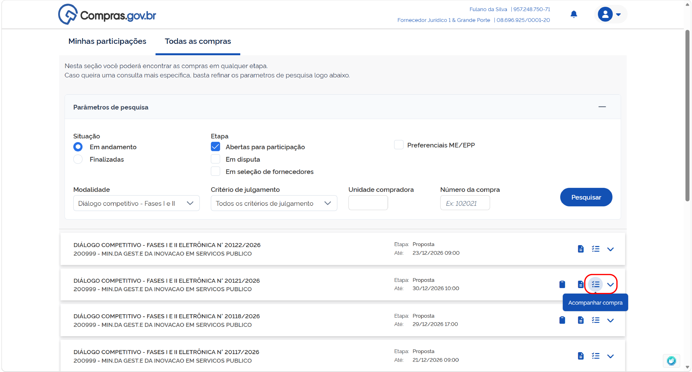
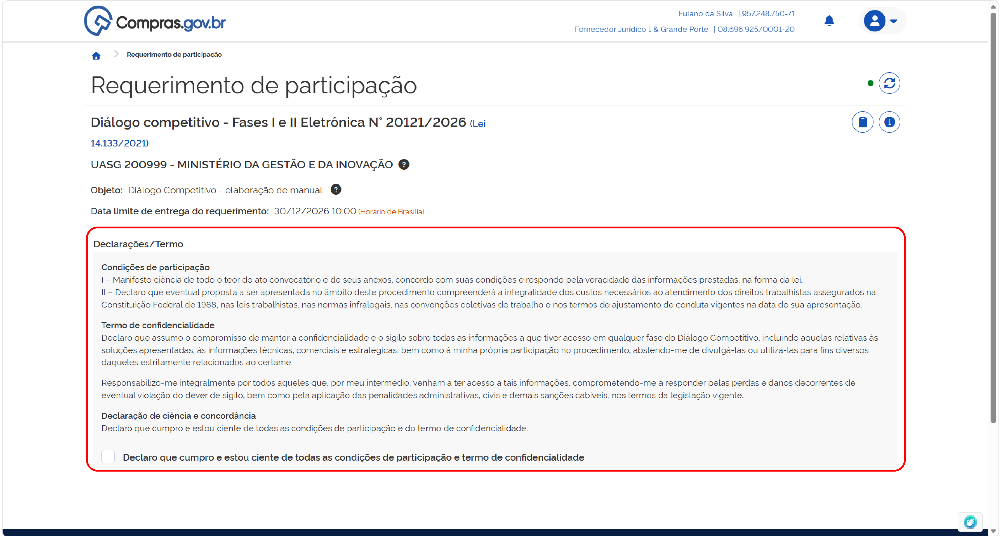
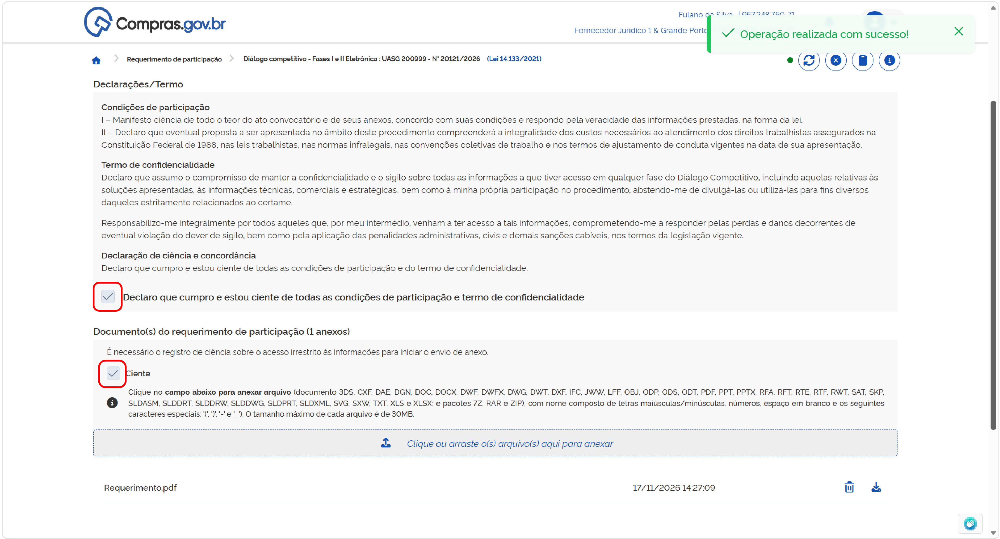
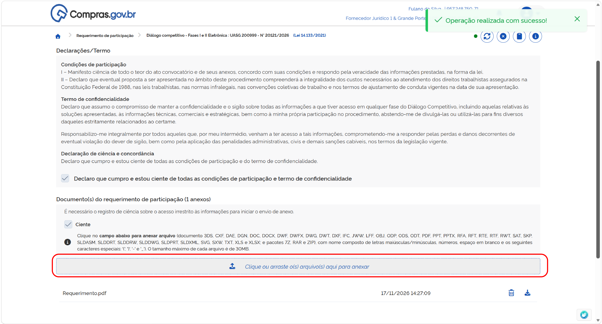

  Tamanho do texto:
  <button onclick="diminuirFonte()" title="Diminuir texto" style="padding: 6px 12px; font-weight: bold; cursor: pointer; border: 1px solid #ccc; border-radius: 4px; background: #f8f9fa;">A-</button>
  <button onclick="resetarFonte()" title="Tamanho normal" style="padding: 6px 12px; font-weight: bold; cursor: pointer; border: 1px solid #ccc; border-radius: 4px; background: #f8f9fa;">A</button>
  <button onclick="aumentarFonte()" title="Aumentar texto" style="padding: 6px 12px; font-weight: bold; cursor: pointer; border: 1px solid #ccc; border-radius: 4px; background: #f8f9fa;">A+</button>

  <button onclick="window.print()" style="background-color: #0056b3; color: white; padding: 6px 16px; border: none; border-radius: 5px; font-size: 14px; cursor: pointer; box-shadow: 0 2px 4px rgba(0,0,0,0.2); margin-left: 10px;">
    🖨️ Imprimir ou baixar esta página
  </button>

PÚBLICO-ALVO: FORNECEDORES

# MANIFESTANDO INTERESSE EM PARTICIPAR DE UM DIÁLOGO COMPETITIVO

**Passo 1:** Acesse a contratação clicando na opção “Acompanhar compra”.

**Passo 2:** Leia as informações apresentadas em tela com atenção. Ao prosseguir no certame, você aceitará todas as condições de participação, em conformidade com a Lei nº 14.133/2021 e demais normativos que regulamentam a modalidade.

**Passo 3:** Clique nas caixinhas para declarar concordância e ciência com todas as condições de participação e do termo de confidencialidade.

**Passo 4:** Faça upload dos arquivos para requerimento de participação, clicando no local indicado ou arrastando documentos para a tela. O upload de arquivos formaliza o requerimento de participação.

 

  <button onclick="window.print()" style="background-color: #0056b3; color: white; padding: 10px 20px; border: none; border-radius: 5px; font-size: 16px; cursor: pointer; box-shadow: 0 2px 4px rgba(0,0,0,0.2);">
    🖨️ Imprimir ou baixar esta página
  </button>

